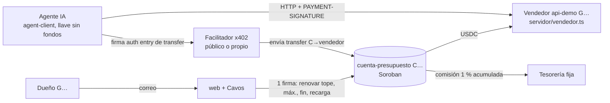
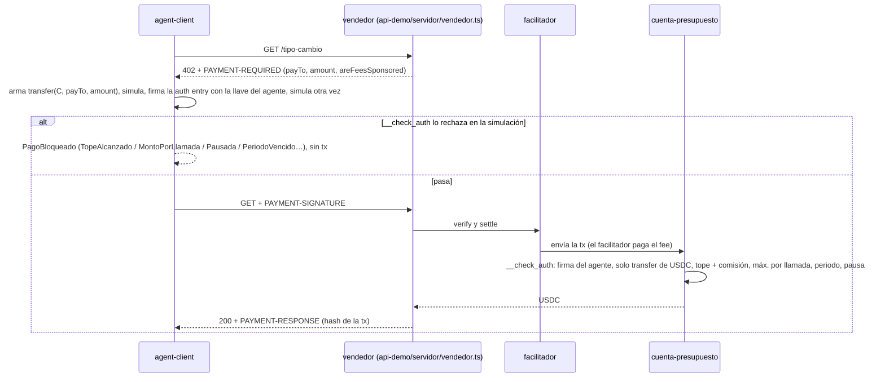
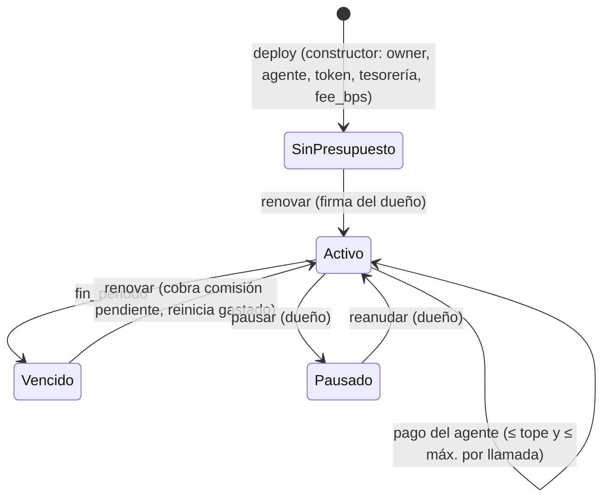

# Arquitectura

Diseño vigente según [PLAN-OPUS §1](PLAN-OPUS.md) (modo A: la cuenta-contrato paga directo). El USDC del mes **vive en la cuenta-presupuesto `C…`**; no hay `approve` ni `transfer_from`.

## Piezas

## Flujo de un pago (x402 `exact`, `from = C…`)

## Ciclo del periodo

## Contrato `cuenta-presupuesto`
- Config (constructor): `owner`, `token` (USDC de Circle en testnet), `tesoreria`, `fee_bps` (100 = 1 %). Sin admin ni `upgrade`.
- Política: `agente` (llave ed25519), `tope`, `max_por_llamada`, `fin_periodo`, `pausada`. Contadores: `periodo`, `gastado`, `comision_pendiente`.
- Funciones del dueño (`owner.require_auth()`): `renovar`, `pausar`, `reanudar`, `cambiar_agente`, `retirar` (no puede tocar la comisión pendiente). Pública: `cobrar_comision`, `estado`.
- Código: [`contracts/cuenta-presupuesto/src/lib.rs`](../contracts/cuenta-presupuesto/AGENTS.md). Corrida de punta a punta en testnet con links: [transacciones](transacciones.md).

<!-- enlaces:auto -->
## Enlaces

- ⬆️ Arriba: [Mapa (hub)](MAPA.md) · [Índice de docs](INDICE.md)
- 📖 Fuente de verdad: [PLAN-OPUS — la biblia](PLAN-OPUS.md)
- Relacionado: [Stack](STACK.md) · [Seguridad](SEGURIDAD.md) · [contracts/cuenta-presupuesto](../contracts/cuenta-presupuesto/AGENTS.md) · [agent-client](../agent-client/AGENTS.md) · [api-demo](../api-demo/AGENTS.md) · [web](../web/AGENTS.md)
- Lo enlazan: [Índice de docs](INDICE.md) · [Mapa (hub)](MAPA.md) · [PLAN-OPUS — la biblia](PLAN-OPUS.md) · [Seguridad](SEGURIDAD.md) · [Stack](STACK.md)
- Tags: #quickchain #docs
<!-- /enlaces:auto -->
