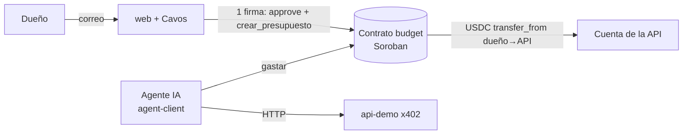
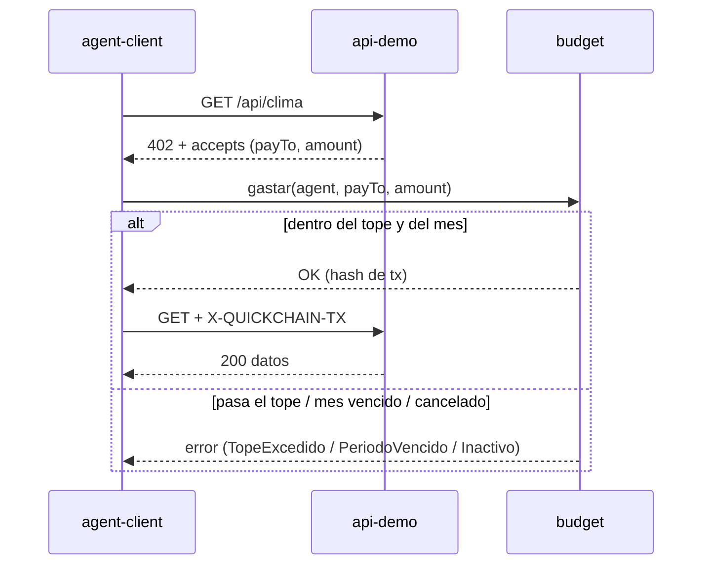
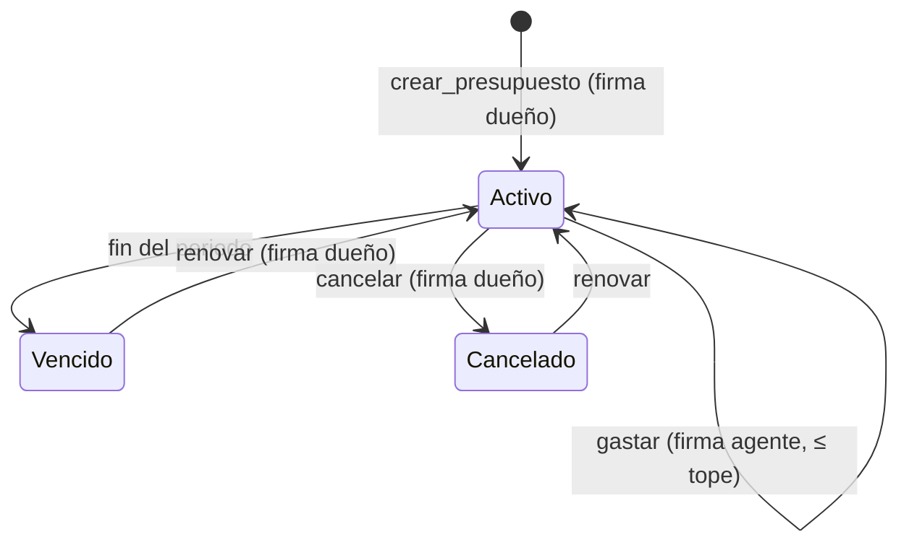

# Arquitectura

## Piezas

## Flujo de un pago

## Ciclo mensual

## Contrato `budget`
Estado por agente: `owner, agent, token, cap, period, inicio, gastado, activo`. El USDC no entra al contrato: queda en la cuenta del dueño y sale con `transfer_from` usando la allowance que el dueño dio una vez.

<!-- enlaces:auto -->
## Enlaces

- ⬆️ Arriba: [Mapa (hub)](MAPA.md) · [Índice de docs](INDICE.md)
- 📖 Fuente de verdad: [PLAN-OPUS — la biblia](PLAN-OPUS.md)
- Relacionado: [Stack](STACK.md) · [Seguridad](SEGURIDAD.md) · [contracts/budget](../contracts/budget/AGENTS.md) · [agent-client](../agent-client/AGENTS.md) · [api-demo](../api-demo/AGENTS.md) · [web](../web/AGENTS.md)
- Lo enlazan: [Índice de docs](INDICE.md) · [Mapa (hub)](MAPA.md) · [PLAN-OPUS — la biblia](PLAN-OPUS.md) · [Seguridad](SEGURIDAD.md) · [Stack](STACK.md)
- Tags: #quickchain #docs
<!-- /enlaces:auto -->
