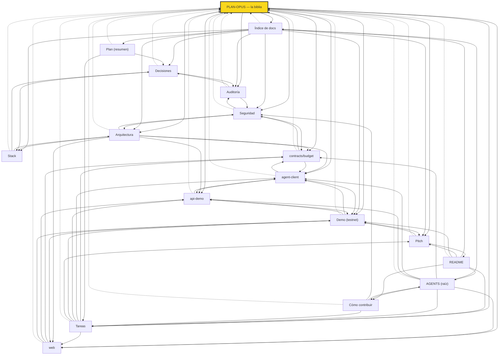

# Mapa de QuickChain (hub de nodos)

Puerta de entrada para agentes: todo nodo enlaza aquí, a [PLAN-OPUS](PLAN-OPUS.md) (la biblia, fuente de verdad obligatoria) y a sus nodos relacionados en la sección **Enlaces** al final. Verificá con `pnpm docs:links`.

## Nodos

- **[PLAN-OPUS — la biblia](PLAN-OPUS.md)** — centro; tareas Q0–Q15 enlazan a paquetes e issues
- [README](../README.md)
- [AGENTS (raíz)](../AGENTS.md)
- [Cómo contribuir](../CONTRIBUTING.md)
- [Tareas](../TAREAS.md)
- [Índice de docs](INDICE.md)
- [Plan (resumen)](PLAN.md)
- [Arquitectura](ARQUITECTURA.md)
- [Stack](STACK.md)
- [Decisiones](DECISIONES.md)
- [Seguridad](SEGURIDAD.md)
- [Auditoría](AUDITORIA.md)
- [Demo (testnet)](DEMO.md) — issue [#5](https://github.com/jxsu404/quickchain/issues/5)
- [Pitch](PITCH.md) — issue [#6](https://github.com/jxsu404/quickchain/issues/6)
- [contracts/budget](../contracts/budget/AGENTS.md) — issue [#1](https://github.com/jxsu404/quickchain/issues/1)
- [agent-client](../agent-client/AGENTS.md) — issue [#2](https://github.com/jxsu404/quickchain/issues/2)
- [api-demo](../api-demo/AGENTS.md) — issue [#3](https://github.com/jxsu404/quickchain/issues/3)
- [web](../web/AGENTS.md) — issue [#4](https://github.com/jxsu404/quickchain/issues/4)

## Tareas → nodos

| Tarea | Nodo | Issue |
|---|---|---|
| Q0 | [../AGENTS.md](../AGENTS.md) | — |
| Q1 | [../contracts/budget/AGENTS.md](../contracts/budget/AGENTS.md) | [#1](https://github.com/jxsu404/quickchain/issues/1) |
| Q2 | [../agent-client/AGENTS.md](../agent-client/AGENTS.md) | [#2](https://github.com/jxsu404/quickchain/issues/2) |
| Q3 | [../api-demo/AGENTS.md](../api-demo/AGENTS.md) | [#3](https://github.com/jxsu404/quickchain/issues/3) |
| Q4 | [../web/AGENTS.md](../web/AGENTS.md) | [#4](https://github.com/jxsu404/quickchain/issues/4) |
| Q5 | [../web/AGENTS.md](../web/AGENTS.md) | [#4](https://github.com/jxsu404/quickchain/issues/4) |
| Q6 | [../web/AGENTS.md](../web/AGENTS.md) | [#4](https://github.com/jxsu404/quickchain/issues/4) |
| Q7 | [DEMO.md](DEMO.md) | [#5](https://github.com/jxsu404/quickchain/issues/5) |
| Q8 | [DEMO.md](DEMO.md) | [#5](https://github.com/jxsu404/quickchain/issues/5) |
| Q9 | [SEGURIDAD.md](SEGURIDAD.md) | — |
| Q10 | [DEMO.md](DEMO.md) | [#5](https://github.com/jxsu404/quickchain/issues/5) |
| Q11 | [../README.md](../README.md) | [#6](https://github.com/jxsu404/quickchain/issues/6) |
| Q12 | [PITCH.md](PITCH.md) | — |
| Q13 | [PITCH.md](PITCH.md) | [#6](https://github.com/jxsu404/quickchain/issues/6) |
| Q14 | [PITCH.md](PITCH.md) | [#6](https://github.com/jxsu404/quickchain/issues/6) |
| Q15 | [../TAREAS.md](../TAREAS.md) | [#6](https://github.com/jxsu404/quickchain/issues/6) |

## Fuera del repo

- Buzón privado del equipo: `jxsu404/quickchain-buzon` (README, AGENTS, `buzon/000-bienvenida.md`)

<!-- enlaces:auto -->
## Enlaces

- Fuente de verdad: [PLAN-OPUS](PLAN-OPUS.md) · Índice: [INDICE](INDICE.md) · [README](../README.md) · [AGENTS](../AGENTS.md)
- Lo enlazan: todos los nodos (sección Enlaces)
- Tags: #quickchain #mapa
<!-- /enlaces:auto -->
