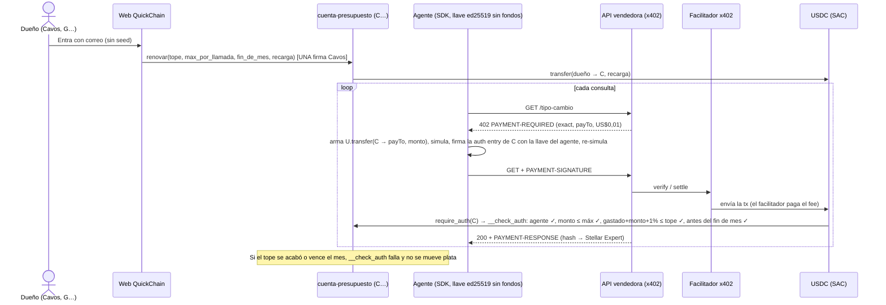

> Plan generado con Claude Opus 5.5 el 2026-10-25. Partes pendientes de decisión (contrato C…, demo en testnet) están marcadas en docs/AUDITORIA.md.

# Plan QuickChain: Pura Vida Ideathon (entrega lunes 26 oct, antes de las 11:30 a.m. CR)

**El plan cabe en el plazo, pero hay dos hallazgos que cambian decisiones antes de arrancar:**

1. **Ya hay proyectos muy parecidos en Stellar.** En `/workspace/fyw-ranking/readmes/` están **AgentAllowance** y **ACAN**. ACAN ganó una mención de 250 USDC en Find Your Way. Los dos usan una *smart account* (cuenta-contrato `C…`) como pagador x402 con tope de gasto en testnet. La buena noticia es que el diseño se puede construir. La mala es que la primitiva no es nueva, así que la diferencia tiene que estar en el producto (Cavos, el mes calendario con una firma, el modelo de 1%) y hay que reconocerlos en el pitch.
2. **El facilitador público rechaza a las cuentas-contrato como pagador.** Según el README de ACAN, el facilitador público tiene un techo de fee de 50.000 stroops y solo acepta eventos `transfer`; un pago con políticas OZ simula en unos 2,3 M stroops. Por eso ACAN corre su propio facilitador. Hay que planear un facilitador propio desde el inicio y tener un modo de compatibilidad (detalle abajo).

Solo leí archivos; no edité nada. Leí también el repo `caja-tica-escudo` (para reutilizar `escudo/riesgo.ts` y la capa de billetera con Freighter) y `CavosStellar.ts`. No pude abrir la spec x402 `exact` de Stellar en la web porque el fetch fue rechazado; queda como algo a verificar.

---

## 0. Resumen en una frase

El dueño entra con su correo (Cavos) y firma una vez al mes un presupuesto en USDC. El agente paga APIs x402 desde una **cuenta-presupuesto** en Soroban cuyo `__check_auth` solo deja pasar transferencias de USDC firmadas por la llave del agente, dentro del tope del mes, del máximo por llamada y antes del fin de mes. El contrato acumula un 1% de comisión que va a la tesorería.

---

## 1. Arquitectura

### 1.1 Piezas

| Pieza | Dónde (propuesto) | Qué hace | Reutiliza |
|---|---|---|---|
| Contrato `cuenta-presupuesto` (Rust/Soroban) | `contracts/cuenta-presupuesto/` | Cuenta-contrato `C…` por dueño. Guarda el USDC del mes, valida al agente y aplica tope, máximo por llamada, periodo, pausa y comisión | Ejemplo `account` de soroban-examples (patrón `__check_auth` + `Vec<{public_key, signature}>`) |
| SDK del agente (TS) | `sdk/` | `fetch` que, ante un 402, arma el pago `exact` con `from = C…` y lo firma con la llave del agente. También lee el estado y genera llaves | `@x402/core`, `@x402/stellar` 2.28 (ya en `package.json`) |
| API vendedora demo | `servidor/vendedor.ts` | `GET /tipo-cambio` a US$0,01 con x402 `exact` (datos de ejemplo, rotulados así) | `escudo/riesgo.ts` casi tal cual |
| Facilitador x402 propio | `servidor/facilitador.ts` | `/verify`, `/settle` y `/supported` del esquema `exact` con techo de fee ajustado y tolerante a cuentas-contrato | Código de facilitador de `@x402/stellar` (verificar el módulo). Si se copia algo de ACAN (MIT), se le da crédito. **No** copiar el plugin AGPL de AgentAllowance |
| Servicio de despliegue | `servidor/cuentas.ts` | `POST /api/cuentas {owner, agente}` despliega la cuenta-presupuesto con constructor. El deployer paga el fee | `stellar-sdk` (`createCustomContract` con `constructorArgs`, verificar) |
| Web | `web/` (Vite + React existente) | Login Cavos, preparar cuenta de testnet, trustline USDC, crear o renovar presupuesto (una firma) y panel | `web/src/billetera/` (ya tiene la interfaz y Freighter: el fallback está hecho) |
| Agente demo | `scripts/agente-demo.ts` | 4 consultas pagadas, la 5.ª bloqueada por el tope y un endpoint "malicioso" de US$1 bloqueado | |
| Cobro de comisión | `scripts/cobrar-comision.ts` | Llama `cobrar_comision()` (función pública) | |

### 1.2 Flujo x402 (modo A: la cuenta-contrato paga directo)



**Modo B (compatibilidad, plan B):** si un vendedor usa un facilitador que no acepta pagadores `C…`, el SDK recarga en trozos chicos (por ejemplo US$0,10) una wallet `G…` del agente desde la cuenta-presupuesto. Esa recarga pasa por el mismo `__check_auth`, así que el tope se respeta. Después la `G…` paga con `exact` estándar, que cualquier facilitador acepta. Lo máximo expuesto en la llave caliente es un trozo. **No requiere cambiar el contrato**, solo el SDK. La `G…` del agente necesita trustline de USDC y XLM para fees (en testnet, friendbot).

### 1.3 Identidad y auth del agente

- El agente tiene una llave ed25519 propia que **no tiene fondos**. Se genera con `npx tsx scripts/agente-nuevo.ts`, la secreta va al `.env` del runtime del agente y la pública se registra en el contrato.
- Cada pago es una auth entry de Soroban firmada sobre la invocación exacta (`transfer(C, payTo, monto)`), con nonce y ledger de vencimiento. No se puede reutilizar ni cambiar de monto o destinatario.
- El vendedor no necesita identificar al agente: el pago x402 es la credencial. Así se evita el problema del "portón con identidad" que planteaba la crítica.
- La firma del agente tiene la misma forma que produce `authorizeEntry` del stellar-sdk con un `Keypair` (`Vec<{public_key, signature}>`). Debería funcionar sin firmador custom; **verificarlo con un test el primer hora**.

### 1.4 Web con Cavos (lo que dice `CavosStellar.ts` y la doc)

- La wallet Stellar de Cavos es una cuenta clásica `G…` con `invokeContract` (simula y firma las auth entries de esa cuenta) y `addTrustline`.
- **Despliegue perezoso:** `invokeContract` y `addTrustline` exigen `status === "ready"`. En testnet hay que fondear la `G…` con friendbot (o usar `execute`) y después confirmar que queda `ready`. **Verificar en el spike.**
- La doc dice que en testnet las invocaciones Soroban patrocinadas "pueden" no estar listas y recomienda `{ sponsored: false }` con cuenta autofinanciada. Por eso friendbot es parte del onboarding de testnet.
- USDC: usar el de Circle en testnet (`USDC:GBBD47IF6LWK7P7MDEVSCWR7DPUWV3NY3DTQEVFL4NAT4AQH3ZLLFLA5`, según la tabla de la doc de Cavos). El ID del SAC se saca con `stellar contract id asset --asset USDC:GBBD47… --network testnet`. Ese SAC es `CBIELTK6YBZJU5UP2WWQEUCYKLPU6AUNZ2BQ4WWFEIE3USCIHMXQDAMA` (USDC oficial de Circle en testnet, no de Writz; corregido 2026-10-25). **No** usar el "Cavos Testnet USDC". Para fondos, el faucet de Circle (ACAN lo usa para Stellar testnet) o una transferencia desde la cuenta del equipo.
- Los argumentos de `invokeContract` se pasan como `xdr.ScVal` ya tipados (`i128`, `u64`, `bytes`), no con la conversión automática.

---

## 2. Contrato Soroban `cuenta-presupuesto`

### 2.1 Storage (todo en *instance* para que `__check_auth` lea y escriba poco)

| Clave | Tipo | Mutable | Notas |
|---|---|---|---|
| `Config` | `{ owner: Address, token: Address, tesoreria: Address, fee_bps: u32 }` | No (se fija en el constructor) | `fee_bps = 100` (1%). Contrato **sin `upgrade`**: nadie, ni nosotros, cambia las reglas |
| `Politica` | `{ agente: BytesN<32>, tope: i128, max_por_llamada: i128, fin_periodo: u64, pausada: bool }` | Solo el dueño | Montos en stroops de 7 decimales (`1 USDC = 10_000_000`) |
| `Contadores` | `{ periodo: u32, gastado: i128, comision_pendiente: i128 }` | La escriben `__check_auth`, `renovar` y `cobrar_comision` | `gastado` incluye la comisión; `comision_pendiente` no se reinicia al renovar |

Se extiende el TTL de la instancia en `renovar` a por lo menos dos periodos (verificar `max_entry_ttl` de testnet). `__check_auth` **no emite eventos**, porque los facilitadores estrictos solo aceptan el evento `transfer` (según ACAN), y se mantiene liviano.

### 2.2 Interfaz

```rust
fn __constructor(env, owner: Address, agente: BytesN<32>, token: Address, tesoreria: Address, fee_bps: u32);

// Dueño (owner.require_auth()). Es la "firma única" del mes.
// Cobra primero la comisión pendiente, después transfiere `recarga` del dueño a la cuenta,
// reinicia `gastado`, sube `periodo` y valida ahora < fin_periodo ≤ ahora + 32 días y max_por_llamada ≤ tope.
fn renovar(env, tope: i128, max_por_llamada: i128, fin_periodo: u64, recarga: i128);
fn pausar(env);                                 // dueño
fn reanudar(env);                               // dueño
fn cambiar_agente(env, agente: BytesN<32>);     // dueño (rotar llave)
fn retirar(env, a: Address, monto: i128);       // dueño; monto ≤ saldo − comision_pendiente

fn cobrar_comision(env) -> i128;  // pública; manda min(pendiente, saldo) a la tesorería fija
fn estado(env) -> Estado;         // lectura: tope, gastado, restante, fin_periodo, pausada, pendiente, saldo
```

```rust
#[contracttype] pub struct FirmaAgente { pub public_key: BytesN<32>, pub signature: BytesN<64> }

impl CustomAccountInterface for CuentaPresupuesto {
    type Signature = Vec<FirmaAgente>;
    type Error = Error;
    fn __check_auth(env: Env, payload: Hash<32>, firmas: Vec<FirmaAgente>, ctxs: Vec<Context>) -> Result<(), Error> {
        // 1. no pausada; timestamp < fin_periodo
        // 2. exactamente 1 firma, public_key == politica.agente; ed25519_verify(payload)
        // 3. cada ctx debe ser Context::Contract con contract == token y fn_name == "transfer";
        //    from == current_contract_address, to != from, 0 < monto ≤ max_por_llamada
        // 4. comision = ceil(monto * fee_bps / 10_000); gastado + monto + comision ≤ tope
        // 5. gastado += monto + comision; comision_pendiente += comision
        // Cualquier otro contexto (approve, crear contrato, otro contrato) → OperacionNoPermitida
    }
}
```

**Errores:** `Pausada=1`, `PeriodoVencido=2`, `FirmaInvalida=3`, `AgenteDesconocido=4`, `OperacionNoPermitida=5`, `MontoInvalido=6`, `MontoPorLlamada=7`, `TopeAlcanzado=8`, `PeriodoInvalido=9`, `ParametrosInvalidos=10`.

**Sobre el caveat del `approve`:** el tope por periodo **no depende de `approve`**. Lo aplica `__check_auth` sobre cada transferencia. Aunque el dueño deposite tres meses, el agente no gasta más del tope del periodo. En el MVP la "firma única" es `renovar` con depósito, porque x402 `exact` exige que el pagador (`C…`) tenga el saldo. El modo "aprobar y jalar" (la plata se queda en la wallet del dueño hasta que se necesita, con `expiration_ledger` como máximo) va en el roadmap; su límite real hay que verificarlo en testnet.

**Comisión de 1%:** el tope incluye la comisión, así que el dueño nunca paga más de lo que firmó. `__check_auth` no puede mover fondos, por eso la comisión se acumula y se cobra en `renovar` o con `cobrar_comision()`. La auth del propio contrato como invocador es implícita.

### 2.3 Tests mínimos (`soroban-sdk` testutils, `env.try_invoke_contract_check_auth`)

1. El agente paga dentro del tope y se actualizan `gastado` y la comisión.
2. Un pago que pasa el tope (contando la comisión) da `TopeAlcanzado`.
3. Un monto mayor a `max_por_llamada` da `MontoPorLlamada`.
4. Una firma de otra llave da `AgenteDesconocido` o `FirmaInvalida`.
5. Un contexto `approve`, otro contrato o un `transfer` con `from` distinto da `OperacionNoPermitida`.
6. Con el periodo vencido da `PeriodoVencido`; después de `renovar`, vuelve a pasar.
7. Con la cuenta pausada da `Pausada`.
8. `renovar` sin la firma del dueño falla, y con `fin_periodo` fuera de rango da `PeriodoInvalido`.
9. `retirar` no puede tocar la comisión pendiente.
10. `cobrar_comision` lo puede llamar cualquiera y solo paga a la tesorería fija.
11. La comisión redondea hacia arriba: US$0,01 deja 1.000 stroops.

---

## 3. Seguridad y amenazas

| Amenaza | Mitigación MVP | Límite honesto |
|---|---|---|
| Se filtra la llave del agente | Sin fondos. Pérdida máxima = lo que queda del tope del mes, en pagos ≤ `max_por_llamada`. El dueño pausa o rota con una firma | Puede pagarle a cualquier `payTo` hasta el tope (la lista de vendedores en cadena es un stretch) |
| Prompt injection o un 402 que pide un monto enorme | `max_por_llamada` en cadena, tope local en el SDK y lista de hosts permitida en el SDK | Un vendedor permitido puede cobrar caro dentro del máximo |
| Agente en loop | Tope por periodo, más un límite de llamadas por minuto en el SDK | |
| Repetir o modificar la auth entry | Nonce y vencimiento de Soroban; la firma está ligada a `transfer(C, payTo, monto)` | |
| Facilitador malicioso | Solo puede enviar la transferencia exacta firmada | Puede cobrar y que el vendedor no entregue (riesgo propio de x402, acotado por llamada) |
| Adelantarse con la liquidación (lo menciona ACAN) | TLS entre el agente y el vendedor | Al vendedor igual le pagan |
| Nosotros (el operador) | Sin admin ni `upgrade`; solo cobramos la comisión acumulada a una tesorería fija | Si se pierde la llave de la tesorería, solo se pierden comisiones |
| El agente intenta otras operaciones con la cuenta | `__check_auth` rechaza todo lo que no sea `token.transfer` desde sí misma; las funciones del dueño exigen la `G…` del dueño | |
| Se compromete la wallet del dueño (Cavos) | Modelo de llave en el dispositivo de Cavos | Fuera de alcance: equivale a perder la wallet |
| Vence el TTL de la instancia | `renovar` extiende el TTL | Si nadie renueva por meses, hay que restaurar |
| Secretos en el repo | Solo `.env.example`; `.gitignore`; job de CI con gitleaks y grep de semillas Stellar `\bS[A-Z2-7]{55}\b`; correr gitleaks sobre **todo el historial** (el repo ya traía llaves de Writz en `.env`) | |
| Legal | No hay custodia: los fondos están en un contrato que solo controla el dueño, que puede retirar cuando quiera. Sin rendimiento ni intereses. Testnet y sin auditar | Hay que confirmar con un abogado si cobrar 1% nos hace VASP o proveedor de pagos (Ley 10.961, SUGEF) |

---

## 4. Tareas por funcionalidad (sin dueños; cada quien reclama en el issue, como dice `TAREAS.md`)

Ahora son las 8:12 p.m. del domingo (hora CR). Arranque a las 8:30 p.m. Un PR por tarea con título `Q#: …`.

| # | Funcionalidad | Entregable | Listo cuando | Estimación | Ventana (CR) |
|---|---|---|---|---|---|
| [Q0](../AGENTS.md) | Base del repo | Writz y Escudo pasan a la rama `archivo/caja-tica` y salen de `main`. `TAREAS.md`, `AGENTS.md` y el README quedan en esqueleto de QuickChain. `.env.example`, job de secretos en CI y `docs/transacciones.md` vacío | `git grep -i -E "writz\|bitcoin"` sin resultados en `main`; CI en verde; gitleaks limpio en el historial | 1 h | 8:30–9:30 p.m. |
| [Q1](../contracts/budget/AGENTS.md) ([#1](https://github.com/jxsu404/quickchain/issues/1)) | Contrato `cuenta-presupuesto` | Contrato, 11 tests, script de deploy y `deployments/testnet.json` | Tests en verde; desplegado en testnet con link a Stellar Expert del contrato | 4 h | 8:45 p.m.–12:45 a.m. |
| [Q2](../agent-client/AGENTS.md) ([#2](https://github.com/jxsu404/quickchain/issues/2)) | Pagador x402 del agente (SDK) | `crearFetchConPresupuesto({cuenta, secretoAgente, rpcUrl, maxPorLlamada, hostsPermitidos})`, `leerEstado`, `agente-nuevo`. Doble simulación (antes y después de firmar) para que el footprint incluya `__check_auth` | Un pago real desde `C…` con link; tests con mock del 402 | 3,5 h | 9:00 p.m.–12:30 a.m. (mientras Q1 termina, contra el `account` de soroban-examples) |
| [Q3](../api-demo/AGENTS.md) ([#3](https://github.com/jxsu404/quickchain/issues/3)) | Vendedor demo y facilitador | `servidor/vendedor.ts` (`/tipo-cambio`, US$0,01) y `/caro` (US$1, para la demo de bloqueo). Facilitador propio con URL configurable. Se prueba primero el público | Un pago `exact` de una `G…` normal y uno de una `C…` liquidados, con links | 2,5 h | 9:00–11:30 p.m. |
| [Q4](../web/AGENTS.md) ([#4](https://github.com/jxsu404/quickchain/issues/4)) | Web con Cavos | Login por correo, preparar cuenta (friendbot), trustline USDC, registrar la llave pública del agente, `renovar` con una firma (`invokeContract`, `{sponsored:false}` si hace falta) | Con un correo nuevo se crea y fondea un presupuesto en testnet; link de la tx de `renovar` | 4 h | 9:00 p.m.–1:30 a.m. (la primera hora es el spike de Cavos) |
| [Q5](../web/AGENTS.md) ([#4](https://github.com/jxsu404/quickchain/issues/4)) | Despliegue de cuentas | `POST /api/cuentas` con la llave del deployer en el entorno del servidor | La web obtiene la `C…` del dueño sin usar la CLI | 1 h | 12:00–1:00 a.m. |
| [Q6](../web/AGENTS.md) ([#4](https://github.com/jxsu404/quickchain/issues/4)) | Panel | Estado on-chain (tope, gastado, restante, fin de mes, comisión) y pagos vía `getEvents` del SAC (`transfer` con `from = C…`), cada uno con link | Muestra datos reales de testnet | 2 h | 1:00–3:00 a.m. |
| [Q7](DEMO.md) ([#5](https://github.com/jxsu404/quickchain/issues/5)) | Agente demo | `scripts/agente-demo.ts`: 4 pagos, el 5.º bloqueado (`TopeAlcanzado`) y `/caro` bloqueado (`MontoPorLlamada`), con mensajes claros | Corre de punta a punta en testnet; imprime los links | 1,5 h | 12:30–2:00 a.m. |
| [Q8](DEMO.md) ([#5](https://github.com/jxsu404/quickchain/issues/5)) | Comisión y costo | `scripts/cobrar-comision.ts`; medir el fee real (en stroops) de un pago desde `C…` y de un `renovar` | Link del cobro; tabla de costo con los hashes como fuente | 1 h | 1:30–2:30 a.m. |
| [Q9](SEGURIDAD.md) | Seguridad y docs | `docs/seguridad.md` (la tabla de la sección 3) y `docs/arquitectura.md` (diagrama) | Revisado por otra persona | 1 h | 2:00–3:00 a.m. |
| [Q10](DEMO.md) ([#5](https://github.com/jxsu404/quickchain/issues/5)) | Evidencia de punta a punta | Corrida limpia que llena `docs/transacciones.md` (deploy, renovar, 4 pagos, bloqueos sin tx, cobro de comisión, pausa y retiro) | Cada fila con link a Stellar Expert | 1,5 h | 2:30–3:30 a.m. y 7:00–8:00 a.m. |
| [Q11](../README.md) ([#6](https://github.com/jxsu404/quickchain/issues/6)) | README | Problema con fuentes, cómo funciona, por qué Stellar, negocio, nota legal, cómo correrlo, créditos a AgentAllowance y ACAN, equipo | Ningún número sin link; dice "testnet, sin auditar" | 1,5 h | 7:00–8:30 a.m. |
| [Q12](PITCH.md) | Validación | Mensajes a quienes construyen agentes (preguntas en la sección 7) | Respuestas reales citables (o el "no") antes de las 9:00 a.m. | 1,5 h activas | Envío 8:30–9:30 p.m.; recolección 7:00–9:00 a.m. |
| [Q13](PITCH.md) ([#6](https://github.com/jxsu404/quickchain/issues/6)) | Pitch | Guion de 3 min en la plantilla de slides y ensayo cronometrado | Dura ≤ 3:00 leído en voz alta | 2 h | 12:00–1:00 a.m. (borrador) y 7:30–8:30 a.m. |
| [Q14](PITCH.md) ([#6](https://github.com/jxsu404/quickchain/issues/6)) | Video | Demo de 2 min grabada primero y pitch después; edición; subida (YouTube no listado + respaldo en Drive) | Link que funciona en una ventana privada | 2 h | 8:30–10:30 a.m. |
| [Q15](../TAREAS.md) ([#6](https://github.com/jxsu404/quickchain/issues/6)) | Entrega en APEX | Propuesta actualizada a QuickChain, repo, video como documento | Confirmación de APEX con captura | 0,5 h | 10:30–11:00 a.m. |

**Puntos de decisión (no negociables):**

- **11:30 p.m.:** ¿una `C…` ya pagó x402 en testnet con algún facilitador? Si no, se pasa al modo B (sección 1.2), con decisión final a la 1:00 a.m.
- **1:30 a.m.:** ¿Cavos ya firmó `renovar`? Si no, se sigue intentando hasta las 3:00 a.m.; después, **Freighter** (ya existe en `web/src/billetera/freighter.ts`) y se dice en el video.
- **3:00 a.m.:** congelar funcionalidades; de ahí en adelante solo arreglos. Turnos para dormir: dos personas de 12:30 a 6:30 a.m. (incluye a quien graba el pitch) y dos de 3:00 a 7:00 a.m.
- **8:00 a.m.:** revisar commits de todos con `git shortlog -sne --since=2026-10-23`. Quien tenga pocos agarra Q9, Q11 o los slides.
- **10:00 a.m.:** congelar el código. **11:00 a.m.:** entregado. Las 11:30 son el margen, no la meta.

**Si vamos atrasados, se recorta en este orden:** panel (se reemplaza por salida de CLI) → servicio de despliegue (se usa la CLI) → Cavos (Freighter) → modo A (modo B). Lo que **nunca** se recorta: contrato, SDK, vendedor y evidencia con links.

---

## 5. MVP de hackathon vs. roadmap

**MVP (lunes 10:00 a.m.):** una cuenta-presupuesto por dueño con un agente; tope por mes calendario (la web calcula el fin de mes en hora CR); máximo por llamada; pausa, rotación de llave y retiro; comisión de 1% acumulada y cobrable; SDK `fetch`; vendedor demo; facilitador propio (y prueba del público); web con Cavos o Freighter; panel; página de evidencia; tests y CI.

**Stretch (solo si sobra tiempo antes de las 3:00 a.m.):** lista de vendedores en cadena (`payees`); contrato *factory* para que el despliegue quede dentro de la misma firma; herramienta MCP `pagar_con_presupuesto`.

**Roadmap de producto:**

1. Varios agentes por dueño, con sub-topes.
2. Modo "aprobar y jalar" (la plata se queda en la wallet del dueño hasta que se usa).
3. PR al facilitador de OZ y a la spec para aceptar pagadores smart account. Sin eso, el agente solo paga a vendedores con facilitador compatible.
4. Evaluar migrar a smart accounts de OZ con la política `spending_limit`.
5. Alertas al 80% del tope.
6. Pagos por lotes o canal para bajar el fee por llamada.
7. Auditoría y mainnet con USDC de Circle.
8. Opinión legal.
9. Suscripciones del lado del vendedor (a futuro, como acordaron).

---

## 6. Guion de la demo (2:00)

| Tiempo | Pantalla | Qué se dice |
|---|---|---|
| 0:00–0:20 | Web: "Entrar con tu correo" y aparece la dirección | "Sin seed phrase ni extensión. Entro con mi correo." |
| 0:20–0:45 | Crear presupuesto: tope US$0,05, máximo US$0,02 por llamada, vence el 1 de noviembre. **Una firma** y link a Stellar Expert | "Esta es la única firma del mes." |
| 0:45–1:20 | Terminal: el agente consulta el tipo de cambio 4 veces; cada una muestra US$0,01, el link y lo que queda | "El agente paga solo, en unos segundos por consulta, y yo no firmo nada." |
| 1:20–1:40 | 5.ª consulta: `TopeAlcanzado`. Llamada a `/caro` (US$1): `MontoPorLlamada`. "Sin tx: no se movió plata" | "El que dice que no es el contrato en Soroban, no el agente." |
| 1:40–1:55 | Panel: gastado, comisión de 1%, tx de `cobrar_comision` y botón "Renovar mes" | "El mes siguiente, una firma y listo." |
| 1:55–2:00 | README con la tabla de transacciones | "Todos los links están en el repo." |

Grabar con txs reales y cortar las esperas. Cada hash que salga en pantalla tiene que estar también en `docs/transacciones.md`.

---

## 7. Pitch (3:00) y validación

| Tiempo | Bloque | Contenido (cada cifra con su fuente) | Criterio |
|---|---|---|---|
| 0:00–0:20 | Gancho | Analogía hablada del Quickpass y el slogan | Presentación |
| 0:20–0:50 | Problema | Con x402 `exact`, 1000 llamadas son 1000 firmas y 1000 tx ([x402 #946](https://github.com/x402-foundation/x402/issues/946)). Stripe dice que hoy pagar una API "often require[s] human intervention" ([Stripe MPP](https://stripe.com/blog/machine-payments-protocol)). La otra opción es darle al agente una wallet caliente con fondos | Validación |
| 0:50–1:30 | Solución | Correo, una firma al mes y el agente que paga x402 solo. El contrato bloquea el sobregasto (captura del bloqueo) | Técnica |
| 1:30–2:00 | Por qué Stellar | Cuentas-contrato con `__check_auth` nativas en Soroban; x402 en Stellar con fees patrocinados y finalidad de ~5 s ([docs de Stellar](https://developers.stellar.org/docs/build/agentic-payments/x402/built-on-stellar)); USDC como SAC; Cavos para Stellar | Stellar fit (30) |
| 2:00–2:30 | Negocio | El dueño paga 1% de lo que gasta el agente, incluido en el tope, sin mensualidad. "Si tu agente gasta US$10, pagás US$0,10." No custodiamos. AgentAllowance y ACAN son herramientas para devs (Freighter o passkey, facilitador propio); QuickChain es el producto para el dueño: correo, mes calendario, una firma | Negocio |
| 2:30–2:50 | Evidencia | "N de M devs que respondieron dijeron…" (con los "no" incluidos), tests y txs en testnet | Validación y técnica |
| 2:50–3:00 | Cierre | Slogan y equipo | |

**Fuera del pitch:** McKinsey, MoneyGram, Circle, BENJI, Blend, volúmenes de x402, Writz y Bitcoin, las palabras "inversión", "rendimiento", "seguro" y "sin riesgo", y la ley por nombre. En el pitch basta con "no custodiamos". La nota legal completa (Ley 10.961, SUGEF, testnet, sin auditar) va en el README y en una tarjeta final del video.

**Preguntas para validar (Q12), dirigidas a quienes construyen agentes** (Cripto Cantina, StarMaker LATAM, grupos de devs de Stellar y ticos), pidiendo permiso para citar:

1. ¿Tus agentes pagan APIs hoy? ¿Cómo (tarjeta, API key prepagada, x402)?
2. ¿Le darías a tu agente una wallet con fondos? ¿Qué te frena?
3. ¿Te sirve un tope mensual que el agente no puede pasar, firmado una vez?
4. ¿Pagarías 1% de lo que gasta el agente? Si no, ¿cuánto?

**Respuestas preparadas:**

- **"¿En qué se diferencia de AgentAllowance o ACAN?"** La primitiva es la misma y los citamos. Nosotros apostamos a la experiencia (correo, mes calendario, una firma), a un contrato mínimo que se puede auditar en una tarde y a un modelo de negocio.
- **"¿Por qué no darle US$20 a una wallet del agente?"** También limita la pérdida a US$20. Lo que falta ahí: máximo por llamada, pausa o rotación sin mover fondos, reinicio mensual y que el agente no tenga que manejar XLM.
- **"¿Facilitador?"** Hoy el público no acepta este tipo de pagador (según ACAN). El vendedor solo cambia la URL del facilitador, y en el roadmap está mandar el cambio upstream.
- **"¿El 1% cubre el fee de red?"** Se responde con el costo medido en Q8. Si no lo cubre en pagos de 1 centavo, se dice.
- **"¿Fork?"** Es open source a propósito. El 1% paga el facilitador, los fees patrocinados, Cavos y el panel.

---

## 8. Modelo de negocio (versión para el README)

- **Cliente:** el dueño de agentes (dev o equipo) que quiere que el agente pague APIs x402 sin darle una wallet con fondos.
- **Precio:** 1% de lo que gasta el agente por medio del presupuesto, descontado en cadena e incluido en el tope. Sin mensualidad ni costo de entrada.
- **Qué paga ese 1%:** el facilitador compatible con cuentas-contrato y sus fees de red; el onboarding con Cavos (Cavos registra cada wallet creada "so it counts toward billing", según `CavosStellar.ts`; **verificar el precio**); el panel y las alertas.
- **Costos que hay que medir:** el fee por pago desde `C…` (Q8). Sin proyecciones.
- **Riesgo principal:** con pagos de US$0,01, el 1% son US$0,0001. Si el fee de red por pago es mayor, el modelo no cierra para micropagos y hace falta cobrar por lotes o canal (roadmap) o poner una comisión mínima (pregunta abierta). Además, la crítica y la fuente de tollstile señalan que en x402 normalmente paga el vendedor. Cobrarle al comprador es una apuesta que hay que validar con Q12.

---

## 9. Riesgos y fallbacks

| Riesgo | Señal | Fallback |
|---|---|---|
| Cavos no firma Soroban o no queda `ready` | Spike de Q4 falla a la 1:30 a.m. | `{sponsored:false}` con friendbot; preguntarle a Adrián; a las 3:00 a.m., Freighter y decirlo en el video |
| El facilitador público rechaza pagadores `C…` | Error de fee o de eventos | Facilitador propio (modo A) o modo B con el facilitador público |
| El facilitador propio tampoco funciona a la 1:00 a.m. | | **Modo directo:** el agente envía la transferencia (con XLM de friendbot) y el vendedor demo verifica el hash. Se rotula honestamente como "no es x402 estándar" |
| El footprint no incluye `__check_auth` | Fallas de `settle` por footprint | Re-simular con la auth firmada (ya está en Q2) |
| La firma del agente no calza con `authorizeEntry` | El test de Q2 falla | Firmador custom que arme la `ScVal` a mano |
| Tooling de Rust o versión de la CLI | Fallos de build | Partir del `account` de soroban-examples y fijar las versiones |
| El faucet de USDC falla | | La cuenta del equipo transfiere USDC de prueba |
| Testnet caída o reseteada | | Video con tomas grabadas a las 8:30 a.m. y links ya guardados |
| Un miembro sin commits | Revisión de las 8:00 a.m. | Q9, Q11 o slides |
| Falla la subida del video | | YouTube y Drive; entregar a las 11:00 a.m. |

---

## 10. Preguntas abiertas

1. ¿El facilitador de OZ ya acepta pagadores smart account o sigue con el techo de 50.000 stroops que reporta ACAN? (No pude abrir la spec `exact` de Stellar para confirmarlo.)
2. ¿`@x402/stellar` 2.28 acepta un firmador custom con dirección `C…`, o hay que armar el payload a mano como hizo ACAN?
3. Cavos: ¿el login por correo está habilitado en la consola para Stellar? ¿Friendbot deja la cuenta `ready`? ¿Las invocaciones Soroban patrocinadas ya funcionan en testnet?
4. ¿Cuánto cuesta en stroops un pago desde `C…`? ¿Cubre el 1%? ¿Ponemos comisión mínima?
5. En producción, ¿quién paga el XLM del facilitador: nosotros con el 1%, o el vendedor?
6. ¿El saldo que no se usa se acumula para el mes siguiente o vuelve solo al dueño?
7. Legal: ¿cobrar 1% sobre lo que gasta el agente nos convierte en VASP o proveedor de pagos según la Ley 10.961?
8. ¿"QuickChain" choca con alguna marca existente? ¿"Quickpass" se puede usar como analogía hablada sin problema de marca?
9. ¿El jurado conoce AgentAllowance y ACAN? ¿Cómo y dónde les damos crédito (README y pitch)?
10. El repo se sigue llamando `caja-tica-escudo`: ¿hay que actualizar el nombre y la descripción del proyecto en APEX?

---

## 11. Slogans

1. **"Tu agente paga solo. Nunca más de tu tope."** *(recomendado)*
2. "Una firma al mes. Cero firmas por llamada."
3. "El agente decide qué comprar. El contrato decide cuánto."
4. "Autonomía para tu agente, tope para tu plata."
5. "Pagos de agentes con freno de mano en Stellar."

**Por qué recomiendo el 1:**

- **Cubre las dos promesas.** La primera mitad es autonomía (sin firmas por llamada) y la segunda es control (lo aplica Soroban).
- **La demo lo prueba en vivo.** En el minuto 1:20 la 5.ª consulta se bloquea, así que el slogan deja de ser una promesa.
- **Es preciso sin prometer de más.** No dice "seguro" ni "sin riesgo"; promete solo lo que el contrato hace cumplir: no pasar del tope que vos firmaste. Eso es más fácil de defender frente a la Ley 10.961 y SUGEF que una frase de seguridad general.
- **Se dice fácil.** Son ocho palabras, suena tico y tiene versión en inglés: *"Your agent pays on its own. Never past your cap."*

**Evitar** "Dale un presupuesto a tu agente, no tu billetera": es casi el tagline de AgentAllowance ("Give AI agents a budget, not your wallet"). El 3 es la mejor alternativa para un público técnico como Daniel.

---

## Fuentes usadas

- Docs del repo: `critica-opus.md`, `modelo-negocio.md`, `validacion-problema.md`, `jueces-y-criterios.md`, `links-hackathon.md`, `ejemplos-pitch.md`, `/workspace/pura-vida-ideathon/analisis.md`.
- Código: `caja-tica-escudo/escudo/riesgo.ts`, `web/src/billetera/`, `TAREAS.md`.
- Cavos: `/workspace/cavos/CavosStellar.ts`, `/workspace/cavos-llms-full.txt`.
- Proyectos previos: `/workspace/fyw-ranking/readmes/karagozemin_AgentAllowance.md`, `/workspace/fyw-ranking/readmes/phoenix-2203_acan.md` ([github.com/phoenix-2203/acan](https://github.com/phoenix-2203/acan)). Mención de ACAN: [anuncio de @TellusCoop](https://x.com/TellusCoop/status/2113394773398557064).
- x402 y pagos: [x402 #946](https://github.com/x402-foundation/x402/issues/946), [x402 en Stellar (docs)](https://developers.stellar.org/docs/build/agentic-payments/x402/built-on-stellar), [Stripe MPP](https://stripe.com/blog/machine-payments-protocol), [blog de x402 en Stellar](https://stellar.org/es/blog/noticias-fundacion/x402-en-stellar).

<!-- enlaces:auto -->
## Enlaces

- ⬆️ Arriba: [Mapa (hub)](MAPA.md) · [Índice de docs](INDICE.md)
- Relacionado: [Índice de docs](INDICE.md) · [Tareas](../TAREAS.md) · [Auditoría](AUDITORIA.md) · [contracts/budget](../contracts/budget/AGENTS.md) · [agent-client](../agent-client/AGENTS.md) · [api-demo](../api-demo/AGENTS.md) · [web](../web/AGENTS.md) · [Seguridad](SEGURIDAD.md) · [Arquitectura](ARQUITECTURA.md) · [Demo (testnet)](DEMO.md) · [Pitch](PITCH.md)
- Lo enlazan: [Mapa (hub)](MAPA.md)
- Tags: #quickchain #docs
<!-- /enlaces:auto -->
